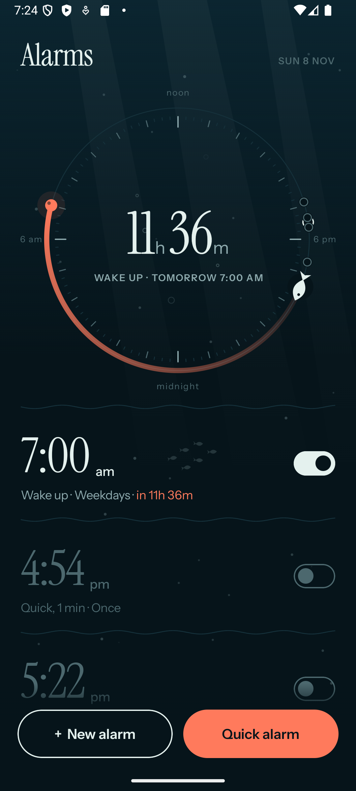
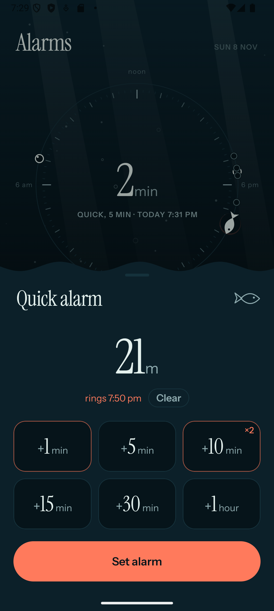
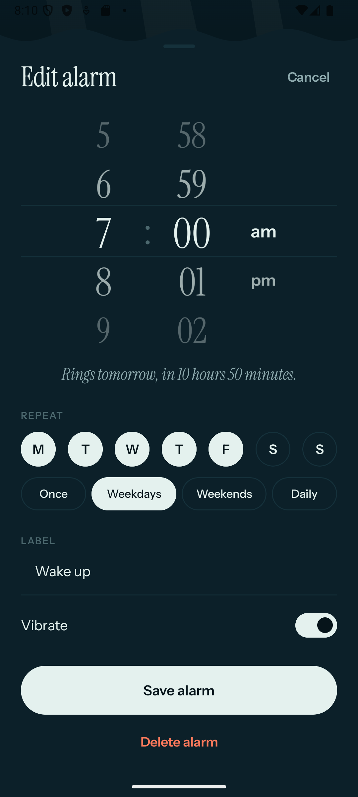
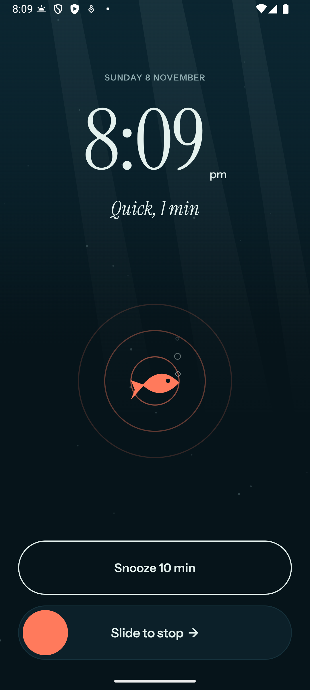
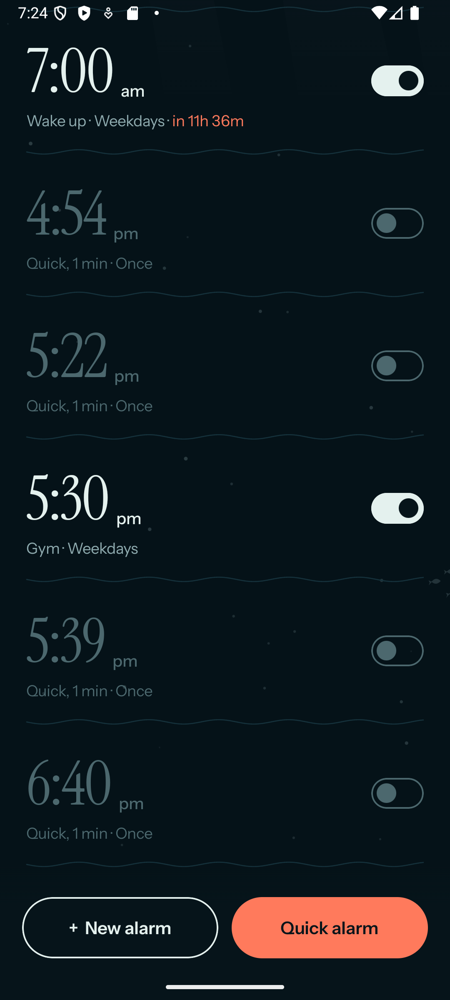

# Alarmify

An alarm clock for Android that feels like looking up from under the sea. Built for Google Pixel in Kotlin and
Jetpack Compose.

<p align="center">
  
  
  
  
</p>

## What it does

**One screen.** Every alarm lives in a single list, with **New alarm** and **Quick alarm** at the bottom,
within reach of your thumb.

**The day ring.** The top of the screen is your day as a 24-hour dial, laid out like the sun's path: noon at the
top, midnight at the bottom, morning on the left. A small fish swims round it to mark the time now, your alarms
sit on it as bubbles, and a coral arc runs from now to the next one, with the countdown in the middle.
**Tap anywhere on the ring to set an alarm at that time**, or tap a bubble to edit that alarm.

**Quick alarm.** For naps, cooking and focus sessions: tap **+1, +5, +10, +15, +30 min** or **+1 hour** as many
times as you like to add up a total. The popup shows the total and the time it will ring as you go. **Set alarm**
saves it as a one-time alarm in your list, accurate to the second.

**New alarm.** Scroll wheels for the time, repeat days with Once / Weekdays / Weekends / Daily shortcuts, a label
and vibration. It tells you in plain words when it will ring ("Rings tomorrow, in 10 hours 50 minutes").

**Ringing.** A full screen over the lock screen with a big **Snooze 10 min** button and a deliberate
**Slide to stop**, so you can't switch it off in your sleep. The sound starts quiet and builds up over about
20 seconds, and it goes quiet by itself after 10 minutes.

**Headphones.** With headphones in (wired, USB-C or Bluetooth) the alarm rings only in your headphones; otherwise
it rings out loud. Plug in or unplug while it's ringing and it switches over.

**Everything else.** Swipe an alarm left to delete it, with Undo. One-time alarms switch off after ringing and
stay in the list, ready to switch back on.

## The look



Deep ocean, kept calm and minimal: dark teal water, seafoam text and one coral accent. Light rays come down from
the surface, specks of marine snow drift past, and now and then a small school of fish crosses behind your
alarms. The light stays at the top of the page, so as you scroll down it falls away and the water gets darker,
as if you're sinking deeper.

The dividers are gentle waves, the popups have a wavy top edge like the surface seen from below, and bubbles pop
when you set a quick alarm or switch one on. When it rings, a coral fish bobs in the middle of spreading ripples.

Type is [Instrument Serif](https://fonts.google.com/specimen/Instrument+Serif) for times and
[Instrument Sans](https://fonts.google.com/specimen/Instrument+Sans) for everything else, both under the SIL Open
Font License and bundled in `app/src/main/res/font`.

<br clear="right" />

## Install it on your phone

1. On the phone, turn on developer options: Settings → About phone → tap **Build number** 7 times. Then
   Settings → System → Developer options → turn on **USB debugging**.
2. Plug the phone into your computer and allow it when asked.
3. Build and install (needs the Android SDK; Android Studio's bundled JDK works for `JAVA_HOME`):

   ```sh
   ./gradlew installRelease
   ```

   Or build with `./gradlew assembleRelease`, copy `app/build/outputs/apk/release/app-release.apk` to the phone and
   open it.

On first launch, allow notifications. If a notice appears above your alarms, tap it: it opens the setting
the app needs to ring on time and over the lock screen.

## How it works

- **Ringing on time.** Alarms are handed to Android's own alarm clock (`AlarmManager.setAlarmClock`), so they
  ring exactly on time even when the phone is asleep, and the status bar shows the alarm icon. They're set
  again after a reboot, an app update, or a time or time-zone change.
- **Over the lock screen.** When an alarm goes off, a foreground service plays the sound and vibrates, and a
  full-screen notification opens the ringing screen. If the app is already open, it switches to the ringing
  screen directly.
- **Headphones.** Android's alarm sound always plays out loud, even with headphones in. So when headphones are
  connected, Alarmify plays the alarm as media pointed at them, and raises a muted media volume to match your
  alarm volume while it rings (putting it back afterwards).
- **Battery.** When the app is closed it uses nothing: no background service, no polling, nothing keeping the
  phone awake until an alarm actually rings. While it's open, all the moving water runs off one shared clock that
  ticks about 20 times a second instead of on every screen refresh, and stops whenever the app isn't visible.
  With Battery Saver on, or animations turned off, the scene stands still. Measured on an emulator over
  10 seconds on the main screen: 450 frames before this, 153 after, 22 with Battery Saver.

## Project layout

```
app/src/main/java/com/evanchen/alarmify/
  data/       Alarm (the model and "when does it ring next") and AlarmRepository (storage)
  alarm/      AlarmScheduler (talks to AlarmManager), AlarmReceiver, BootReceiver
  ring/       AlarmService (sound, vibration, headphones), RingActivity and RingScreen
  ui/         MainScreen, DayRing, QuickSheet, AlarmEditor, WheelPicker, Ocean (the water),
              Fish, Ambient (the battery-friendly animation clock), Theme, Components, Format
```

Alarms are stored on the phone only (device-protected storage, so they can ring after a reboot before you
unlock). Nothing is sent anywhere.

Requires Android 10 (API 29) or newer.
